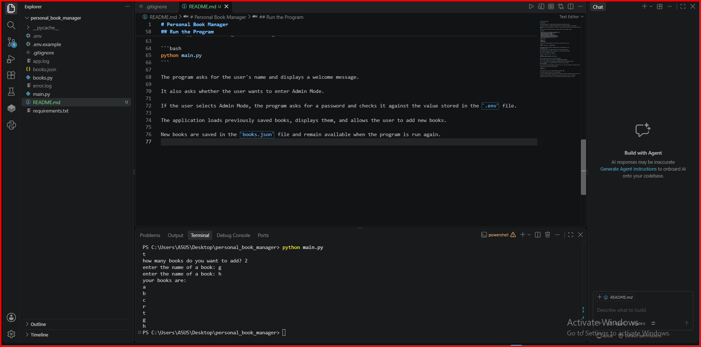

# Personal Book Manager


## Description

Personal Book Manager is a simple command-line application developed using Python.

This project allows users to manage their personal book list by adding, displaying, and saving books.

The program stores book information in a JSON file, so the data remains available after closing and running the application again.

It also includes an Admin Mode that checks a password stored in an environment variable.
This project helps users manage their personal books and organize them by priority.


## Features

- Enter the user's name and display a welcome message.
- Add multiple books to a personal book list.
- Display previously saved books.
- Save book information in a JSON file.
- Load saved books when the program starts.
- Handle missing book data files using try/except.
- Provide an Admin Mode with password validation.
- Read the admin password from a .env file.
- Assign a priority level (low, medium, or high) to each book.
- Display each book with its name and priority level.

## Requirements

- Python
- python-dotenv
## Installation

To install the required packages, open a terminal in the project folder and run:

```bash
python -m pip install -r requirements.txt
```

This command installs the external packages listed in the requirements.txt file.
## Environment Setup

The application uses an environment variable to store the Admin Mode password.

Before running the program, create a file named `.env` in the main project folder.

You can use `.env.example` as a template.

Add the following line to your `.env` file:

```env
BOOK_MANAGER_ADMIN_PASSWORD=your_password_here
```

Replace `your_password_here` with your own test password.

The environment variable name must be exactly `BOOK_MANAGER_ADMIN_PASSWORD`.

The `.env` file contains local configuration information and must not be uploaded to GitHub.

The `.env.example` file is a template and does not contain the actual password.
## Run the Program

After installing the required packages and setting up the `.env` file, open a terminal in the project folder.

Run the application using the following command:

```bash
python main.py
```

The program asks for the user's name and displays a welcome message.

It also asks whether the user wants to enter Admin Mode.

If the user selects Admin Mode, the program asks for a password and checks it against the value stored in the `.env` file.

The application loads previously saved books, displays them, and allows the user to add new books.

New books are saved in the `books.json` file and remain available when the program is run again.
## Screenshot

The following screenshot shows an example of the Personal Book Manager application running in the terminal.


## Project Structure

The project has the following structure:

```text
personal_book_manager/
├── main.py
├── books.py
├── requirements.txt
├── .gitignore
├── .env.example
├── README.md
└── images/
└── screenshot.png
```

- `main.py`: Runs the application and handles user input and Admin Mode.
- `books.py`: Contains functions for displaying, saving, and loading books.
- `requirements.txt`: Lists the external Python packages required by the project.
- `.gitignore`: Specifies files and folders that Git should ignore.
- `.env.example`: Provides an example of the required environment variable.
- `README.md`: Explains how to install, configure, and run the project.
- `images/screenshot.png`: Shows an example of the application running.

The application also uses the following local files:

- `books.json`: Stores book data and is created automatically.
- `.env`: Stores the local Admin Mode password.
- `__pycache__/`: Contains Python-generated cache files.

These local files are ignored by Git.
## How It Works

1. The program asks the user to enter their name.
2. It displays a welcome message.
3. The program asks whether the user wants to enter Admin Mode.
4. If the user selects Admin Mode, the program asks for a password.
5. The entered password is compared with the password loaded from the `.env` file.
6. The program loads previously saved books from `books.json`.
7. If `books.json` does not exist, an empty list is used.
8. The program displays the existing books.
9. The user enters the number of new books they want to add.
10. For each new book, the program asks for the book name.
11. The program asks for a priority level (low, medium, or high).
12. If the priority is invalid, the program asks again.
13. Each book is stored with its name and priority.
14. The updated book list is saved to `books.json`.
15. Finally, the program displays the books with their priority levels.
### Book Priority Example

Each new book has a name and a priority level.

The available priority levels are:

- low
- medium
- high

Example of a book stored in JSON:

```json
{
"name": "Python Basics",
"priority": "high"
}
```

## Troubleshooting

### 1. Python is not recognized

If the terminal shows that Python is not recognized, make sure Python is installed and added to the system PATH.

On Windows, you can also try:

```bash
py main.py
```

### 2. ModuleNotFoundError: No module named 'dotenv'

This error means that the required `python-dotenv` package is not available in the Python environment used to run the program.

Install the required packages:

```bash
python -m pip install -r requirements.txt
```

### 3. Admin password is not configured

Make sure a `.env` file exists in the main project folder.

It should contain:

```env
BOOK_MANAGER_ADMIN_PASSWORD=your_password_here
```

Replace the example value with your own test password and run the program again.

### 4. The admin password is incorrect

Check that the password entered in the terminal matches the value in the `.env` file.

The password is case-sensitive.

### 5. The books.json file is missing

The `books.json` file is created automatically when the program saves book data.

If the file does not exist, the program starts with an empty list.

Run the program and complete the book entry process to create the file.

